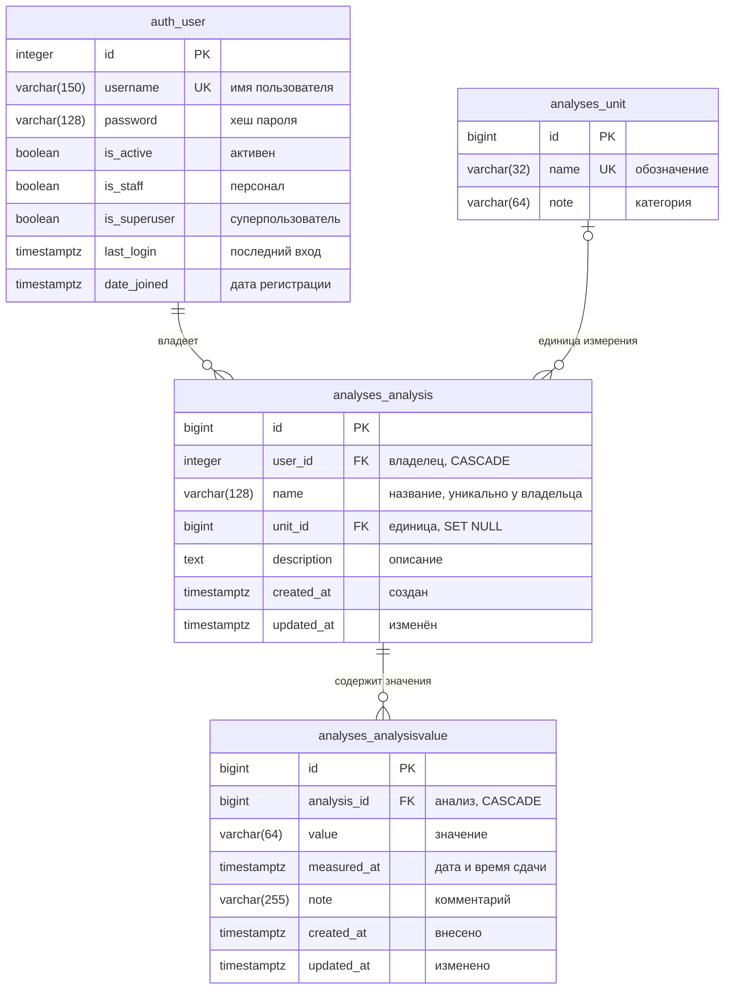

# 4. Модель данных

## 4.1. Сущности

| Сущность | Модель Django | Таблица | Описание |
| --- | --- | --- | --- |
| Пользователь | `django.contrib.auth.models.User` | `auth_user` | учётная запись |
| Единица измерения | `Unit` | `analyses_unit` | общий справочник единиц |
| Анализ | `Analysis` | `analyses_analysis` | отслеживаемый показатель пользователя |
| Значение анализа | `AnalysisValue` | `analyses_analysisvalue` | результат одной сдачи анализа |

## 4.2. ER-схема



Изображение схемы: [`diagrams/02_er.png`](../diagrams/02_er.png).

Связи:

- `auth_user 1 — * analyses_analysis`: у пользователя может быть много анализов; анализ принадлежит одному
  пользователю. При удалении пользователя его анализы удаляются (`CASCADE`).
- `analyses_unit 0..1 — * analyses_analysis`: у анализа может быть не указана единица; одна единица используется
  многими анализами. При удалении единицы ссылка обнуляется (`SET NULL`).
- `analyses_analysis 1 — * analyses_analysisvalue`: у анализа много значений; значение относится к одному анализу.
  При удалении анализа его значения удаляются (`CASCADE`). Владелец значения определяется через анализ.

## 4.3. Unit — единица измерения

| Поле | Тип Django | Тип PostgreSQL | Ограничения | Описание |
| --- | --- | --- | --- | --- |
| id | BigAutoField | bigint | PK | идентификатор |
| name | CharField(32) | varchar(32) | NOT NULL, UNIQUE | обозначение: «ммоль/л», «г/л», «%» |
| note | CharField(64) | varchar(64) | NOT NULL, может быть пустой строкой | категория: «концентрация», «доля», «давление» |

- Сортировка по умолчанию: `name`.
- Строковое представление: `name`.
- `verbose_name`: «Единица измерения» / «Единицы измерения».

## 4.4. Analysis — анализ

| Поле | Тип Django | Тип PostgreSQL | Ограничения | Описание |
| --- | --- | --- | --- | --- |
| id | BigAutoField | bigint | PK | идентификатор |
| user | ForeignKey(User) | bigint | NOT NULL, FK → auth_user, ON DELETE CASCADE, `related_name="analyses"` | владелец |
| name | CharField(128) | varchar(128) | NOT NULL | название: «Глюкоза» |
| unit | ForeignKey(Unit) | bigint | NULL, FK → analyses_unit, ON DELETE SET NULL, `related_name="analyses"` | единица измерения |
| description | TextField(max_length=2000) | text | NOT NULL, может быть пустой строкой | описание, референсные значения |
| created_at | DateTimeField(auto_now_add) | timestamptz | NOT NULL | дата создания |
| updated_at | DateTimeField(auto_now) | timestamptz | NOT NULL | дата последнего изменения |

- Ограничение уникальности: `UniqueConstraint(Lower("name"), "user", name="uq_analysis_user_name_ci")` —
  название уникально в пределах пользователя без учёта регистра.
- Индекс: `(user, name)`.
- Сортировка по умолчанию: `name`.
- Строковое представление: `name`.
- `verbose_name`: «Анализ» / «Анализы».

## 4.5. AnalysisValue — значение анализа

| Поле | Тип Django | Тип PostgreSQL | Ограничения | Описание |
| --- | --- | --- | --- | --- |
| id | BigAutoField | bigint | PK | идентификатор |
| analysis | ForeignKey(Analysis) | bigint | NOT NULL, FK → analyses_analysis, ON DELETE CASCADE, `related_name="entries"` | анализ |
| value | CharField(64) | varchar(64) | NOT NULL, непустое | значение: «5.4», «120/80», «отрицательно» |
| measured_at | DateTimeField(default=timezone.now) | timestamptz | NOT NULL, не в будущем (проверка в форме) | дата и время сдачи |
| note | CharField(255) | varchar(255) | NOT NULL, может быть пустой строкой | комментарий |
| created_at | DateTimeField(auto_now_add) | timestamptz | NOT NULL | дата внесения |
| updated_at | DateTimeField(auto_now) | timestamptz | NOT NULL | дата последнего изменения |

- Индекс: `(analysis, -measured_at)`.
- Сортировка по умолчанию: `-measured_at`.
- Строковое представление: `"<значение> (<дата сдачи>)"`.
- `verbose_name`: «Значение анализа» / «Значения анализов».

## 4.6. Начальные данные

**Справочник единиц измерения** (заполняется миграцией данных):

| Обозначение | Категория |
| --- | --- |
| ммоль/л | концентрация |
| мкмоль/л | концентрация |
| пмоль/л | концентрация |
| г/л | концентрация |
| г/дл | концентрация |
| мг/л | концентрация |
| мг/дл | концентрация |
| ×10⁹/л | количество клеток |
| ×10¹²/л | количество клеток |
| % | доля |
| Ед/л | активность ферментов |
| мЕд/л | активность ферментов |
| фл | объём |
| мм/ч | скорость |
| мм рт. ст. | давление |
| уд/мин | частота |
| °C | температура |
| кг | масса |

**Администратор** создаётся командой `python manage.py createsuperuser`.

## 4.7. Основные запросы

Список анализов пользователя (FR-6):

```python
Analysis.objects.filter(user=request.user) \
    .select_related("unit") \
    .annotate(values_count=Count("entries")) \
    .order_by("name")
```

Получение анализа с проверкой владельца (FR-5, FR-9–FR-11):

```python
get_object_or_404(Analysis, pk=pk, user=request.user)
```

Значения анализа (FR-12):

```python
analysis.entries.order_by("-measured_at")
```

Получение значения с проверкой владельца (FR-14, FR-15):

```python
get_object_or_404(AnalysisValue, pk=pk, analysis__user=request.user)
```
